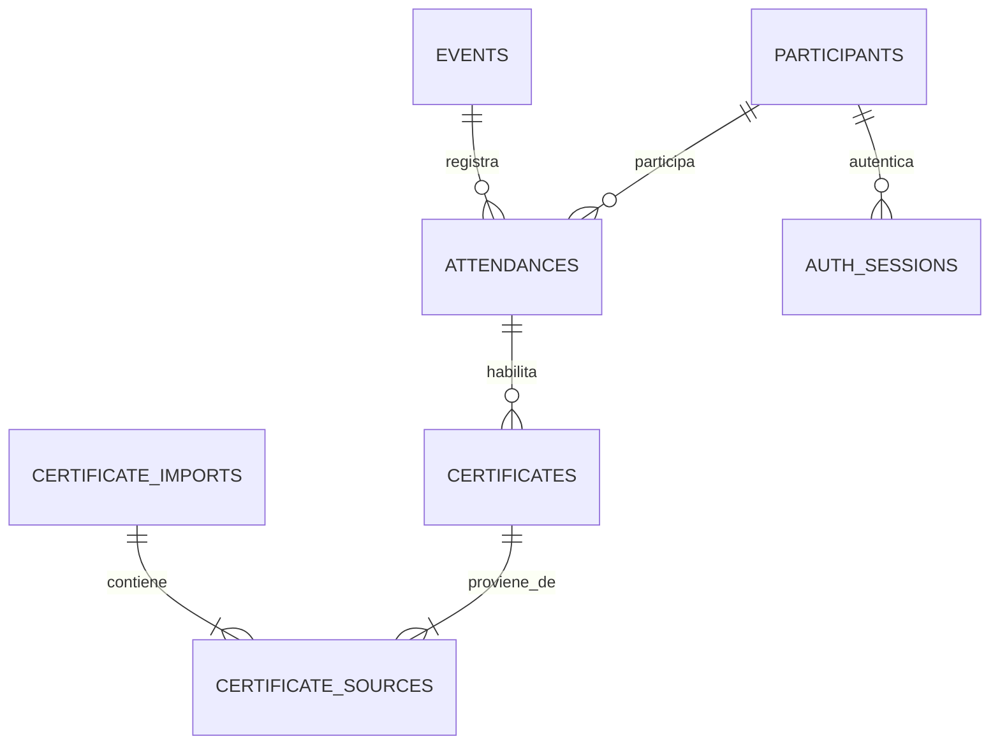

# Catálogo local de certificados

PostgreSQL administra el acceso por correo, las participaciones y el estado de cada certificado. S3 almacena los PDF emitidos en un bucket privado. El backend usa la sesión OTP para comprobar el titular y el estado antes de solicitar el objeto.

## Relaciones



| Tabla | Datos y reglas |
| --- | --- |
| `participants` | Correo normalizado único, nombre, estado habilitado y vínculo único al `sub` de Cognito tras el OTP. |
| `events` | Título y categoría de la actividad. Fecha y duración admiten valores desconocidos. |
| `attendances` | Una participación por persona y actividad. Su campo `available` pertenece a la descarga de demostración. |
| `certificates` | Varios certificados por participación, según la plantilla y el rol. La clave foránea compuesta exige una participación válida. Los estados son `pending`, `published` y `revoked`. El par bucket/clave es único. |
| `certificate_imports` y `certificate_sources` | Identifican el archivo por SHA-256 y conservan la hoja, la fila y la fecha del Excel para cada certificado importado. |
| `otp_challenges`, `auth_sessions`, `rate_limits` | Desafíos OTP, sesiones revocables y límites de autenticación existentes. |

## Carga inicial

Desde `Backend`, con el entorno local configurado según el [README](../README.md):

```sh
docker compose up -d --wait db
poetry run alembic upgrade head
poetry run alembic check
poetry run ucts import-certificates --dry-run
poetry run ucts import-certificates
```

El comando usa `data/raw/Datos.xlsx` por defecto. Puedes indicar otro libro con `--workbook`. Lee las hojas `Unificado`, `Posters` y `Ganadores poster`. Las hojas de asistencia de origen ya están consolidadas en `Unificado`.

La revisión del libro actual devuelve 1.107 filas con datos, 1.090 filas válidas, 723 correos, 29 actividades y 1.076 certificados distintos. Se excluyen 8 filas por correo inválido y 9 filas de 4 correos con documentos diferentes. El comando identifica cada caso por hoja y fila. Los números de identificación se comparan en memoria para detectar esos cruces.

Se unifican filas del mismo titular, actividad, plantilla, rol, nombre y, para pósteres, autoría. Cada fila conserva su trazabilidad. La fecha del evento se registra si todas sus filas válidas coinciden en el día. Las horas quedan vacías porque el Excel carece de duración. La carga es transaccional y repetir el mismo archivo conserva el estado de publicación. Un libro corregido se importa de forma aditiva. Si una corrección cambia un titular, revisa y revoca el certificado anterior antes de publicar el nuevo.

Para permitir OTP, el correo debe tener una participación y estar habilitado. En modo local el código aparece en el log. Para enviar OTP por correo, la cuenta también debe existir y estar habilitada para EMAIL_OTP en [Cognito](cognito.md).

## Vincular archivos de S3

1. Sube los PDF emitidos a un bucket privado y configura `CERTIFICATE_S3_BUCKET` y `AWS_REGION` en el backend. Usa una identidad AWS con lectura de objetos del prefijo de certificados. Si el bucket tiene versiones, concede también lectura de la versión.
2. Crea un CSV UTF-8 dentro de `data/` con las columnas de abajo. Verifica para cada fila que el PDF corresponde al titular y a la edición del Excel que vas a indicar. El historial de generación y envío sirve para cotejar las referencias. En el historial revisado, cuatro nombres de archivo aparecen vinculados a más de un correo. Revisa esos PDFs antes de asignarlos.
3. Ejecuta el comando con el CSV y el mismo libro que importaste. La clave S3 debe ser la ruta exacta dentro del bucket. Incluye únicamente las filas que ya verificaste.

```csv
hoja,fila_excel,correo,s3_key
Unificado,2,persona@example.com,certificados/archivo.pdf
```

```sh
poetry run ucts publish-certificates --manifest data/manifiesto-s3.csv
```

El comando coteja hoja, fila y correo con la carga. Rechaza claves que apunten a certificados distintos, verifica la existencia y el tamaño de cada objeto en S3 y guarda el identificador de versión si está disponible. Aplica el manifiesto en una transacción. Los objetos admiten hasta 20 MiB. En un bucket sin versiones, usa claves inmutables para preservar el contenido asociado a cada certificado.

Con una sesión válida, `GET /api/me/certificates` lista los certificados del titular. `GET /api/me/certificates/{id}` devuelve el PDF publicado. El navegador recibe el archivo a través del backend y usa la cookie de sesión. Angular requiere conectar esas rutas y las de OTP para ofrecer el flujo a usuarios.

## Administración local

En DBeaver puedes consultar el resumen por estado:

```sql
SELECT status, count(*) FROM certificates GROUP BY status ORDER BY status;
```

Para revocar un certificado en PostgreSQL, actualiza su estado a `revoked` usando su ID. Para deshabilitar una cuenta, pon `participants.enabled` en `false` y elimina sus filas en `auth_sessions` dentro de la misma transacción. Mantén el Excel, los manifiestos y los respaldos con acceso restringido. El directorio `data/` está excluido de Git.
